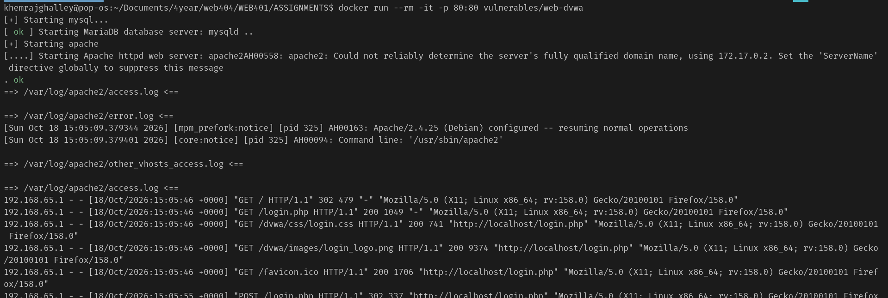
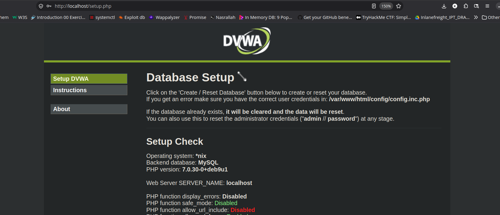
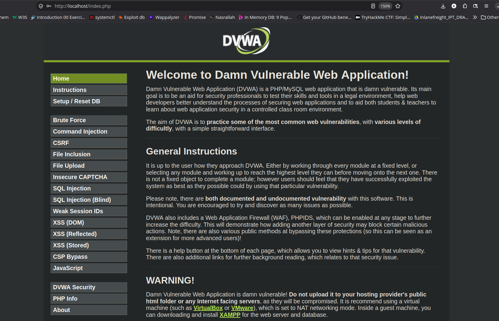
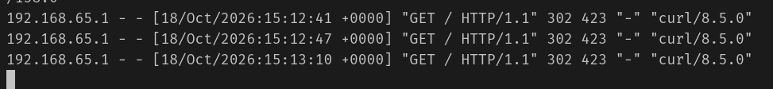
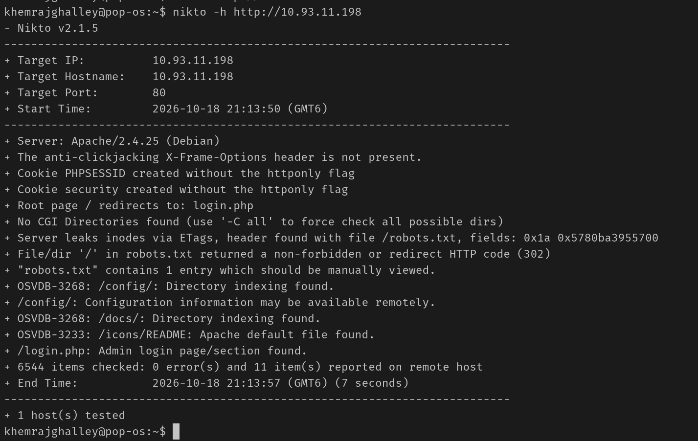
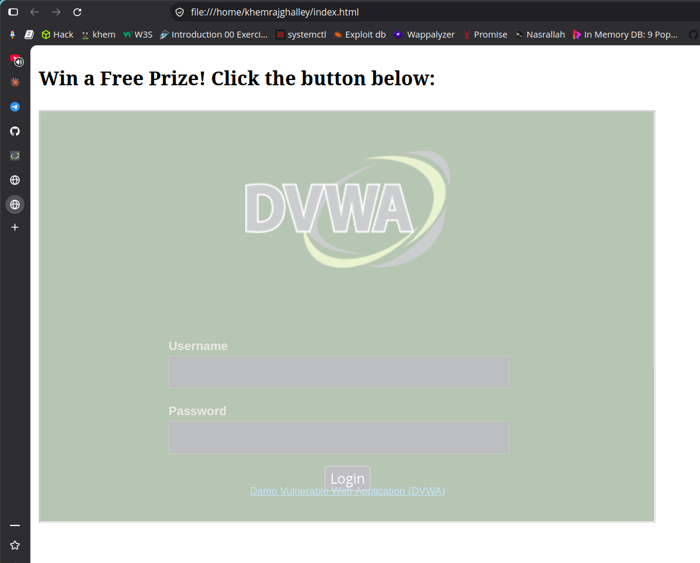

# Assignment 1
## Nikto

**Aim**
The aim of this assignment is to perform a vulnerability assessment of a web server using Nikto, and then focus on one key finding in detail.

**Objective**
- To perform a vulnerability assessment of a web server using Nikto.
- To focus on one key finding in detail.

### What is Nikto?
Nikto is a command-line tool that scans web servers for things like:
- Outdated software versions
- Dangerous or misconfigured files/scripts
- Missing security headers
- Default files that shouldn't be exposed
- Common misconfigurations

For this assignment I used Nikto to scan a vulnerable web server and then focused on one key finding in detail: **Clickjacking caused by missing anti-framing headers.**


### Procedure

1. First I pulled the DVWA docker image from the Docker Hub repository using the following command:
```
docker pull vulnerables/web-dvwa
```

2. Then ran the docker image using the following command:
```
docker run --rm -it -p 80:80 vulnerables/web-dvwa
```


3. The DVWA website was then accessible from the host browser.


4. After setting up the database and logging in with the default credentials (admin / password), I got the DVWA home page.


5. Next, I retrieved the host IP address (`ifconfig`) and verified that the vulnerable website was reachable from the attacker machine using `curl`.


6. Finally, I ran the Nikto scan against the DVWA server from the Kali VM.

Command used:
```
nikto -h http://10.93.11.198
```

Scan output:


### Findings and Interpretation

| | Finding | Risk Level | Explanation |
|---|---|---|---|
| 1 | Missing `X-Frame-Options` header | Medium | The server does not tell the browser to block framing, so the page can be loaded inside an `<iframe>` on another site. This is the root cause of **clickjacking**. |
| 2 | Missing `Content-Security-Policy` (no `frame-ancestors`) | Medium | There is no second layer of framing protection either, so modern browsers also allow the page to be embedded. |
| 3 | `PHPSESSID` cookie created without the `HttpOnly` flag | Medium | JavaScript can read the session cookie, which makes the clickjacking impact worse if combined with other attacks. |
| 4 | Missing `X-Content-Type-Options` header | Low | The browser may guess file types (MIME sniffing) instead of following the declared type. |
| 5 | Apache version disclosed in the Server banner | Low | The exact version is shown, which helps an attacker look up known exploits. |

### Focused Vulnerability: Clickjacking

**What it is**
Clickjacking (UI redressing) is an attack where a victim is tricked into clicking something different from what they think they are clicking. The attacker loads the real, trusted site inside an invisible or transparent `<iframe>` on their own malicious page, then places fake buttons or images on top. When the user clicks the fake element, the click actually lands on the hidden real page, for example a "Confirm", "Delete", or "Transfer" button on a logged-in account.

**Why DVWA is vulnerable**
The Nikto scan reported that the `X-Frame-Options` header is missing. This header is what tells the browser whether a page is allowed to be displayed in a frame. Because it is absent (and there is no `Content-Security-Policy: frame-ancestors` rule either), the browser happily lets any website embed the DVWA pages in an iframe.

**Simple proof of concept**
To confirm the finding, I created a small HTML file on the attacker side that embeds the target in an iframe:

```html
<!DOCTYPE html>
<html>
  <body>
    <h3>Win a Free Prize! Click the button below:</h3>
    <!-- The real DVWA page loads transparently on top of the fake button -->
    <iframe src="http://10.93.11.198:80/login.php"
            style="opacity:0.3; width:600px; height:400px;"></iframe>
  </body>
</html>
```

Opening this file in a browser successfully loaded the DVWA login page inside the frame, which proves the page can be framed by an attacker-controlled site. A real attack would set `opacity:0` to make the frame invisible and line the fake button up with a sensitive button on the real page.



**Impact**
If a logged-in DVWA user visits the malicious page, their clicks can be redirected to perform actions on their account without their knowledge, such as changing settings or submitting forms. The user sees the attacker's page but is actually interacting with the hidden real site.

### Risk Analysis
The main issue in this assessment is the missing anti-framing protection, which directly enables clickjacking. On its own it does not steal data instantly, but it lets an attacker trick a logged-in user into performing unwanted actions. The missing `HttpOnly` flag and MIME-sniffing header make the overall situation worse, because weak browser protections stack together and give an attacker more room to work.

### Recommendations
- Add the header `X-Frame-Options: DENY` (or `SAMEORIGIN` if framing by the same site is needed).
- Add `Content-Security-Policy: frame-ancestors 'none';` as a modern, more flexible replacement.
- Enable the `HttpOnly` flag on session cookies.
- Add `X-Content-Type-Options: nosniff`.
- Hide the Apache version using `ServerTokens Prod` and `ServerSignature Off`.

### Conclusion
The Nikto vulnerability assessment of the DVWA server found several weaknesses, and this report focused on the most important one: **clickjacking caused by the missing `X-Frame-Options` header**. A simple iframe proof of concept confirmed that the page can be embedded by an attacker's site. The finding was expected because DVWA is built to be insecure for training, and the assessment shows how a single missing header can expose users to real attacks, along with how quickly Nikto can detect such issues.