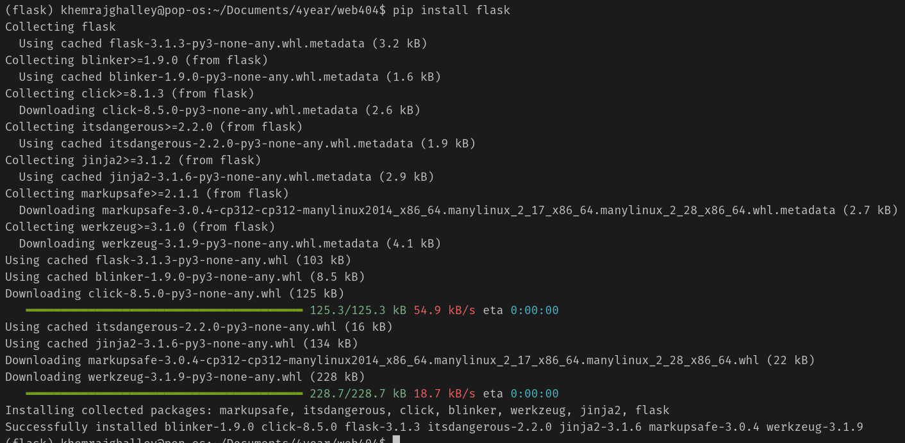
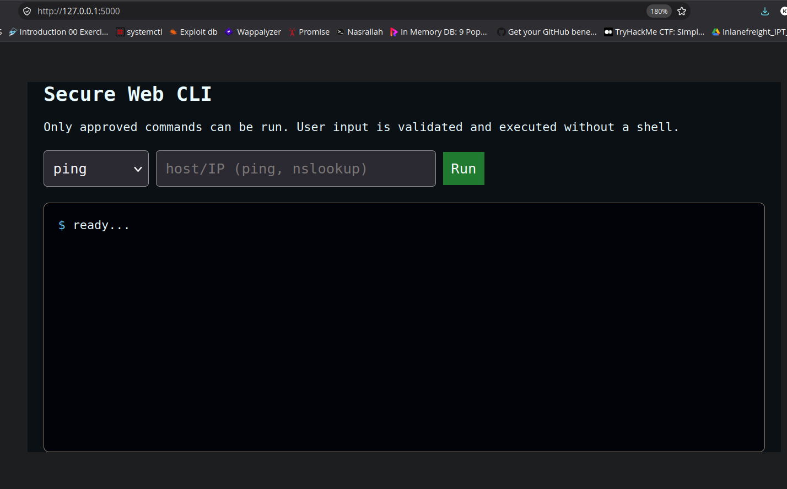
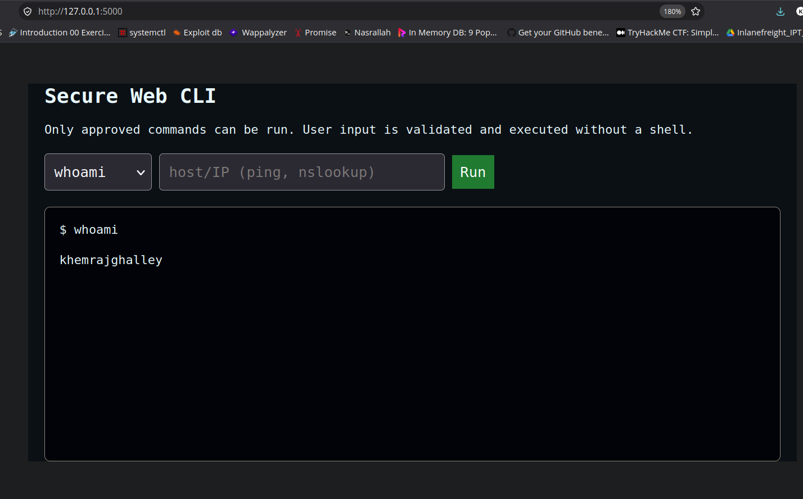
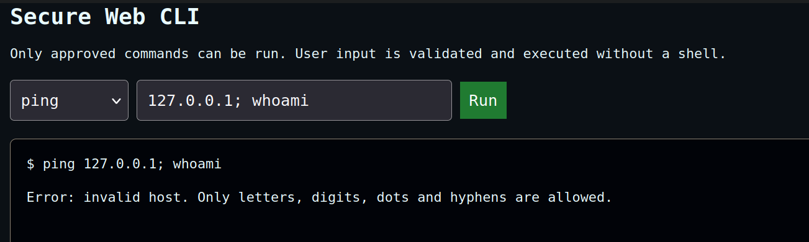
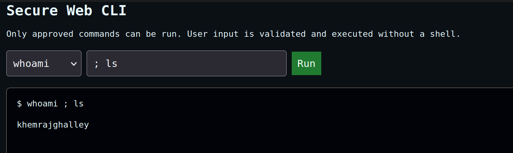

# Assignment 2
## Secure Command-Line Interface in a Web Application

### Objective
Build a small web application with a command-line interface (a browser page where a user can run commands on the server) and protect it against **command injection**.

### What is Command Injection?
Command injection happens when a web application takes user input and passes it to the operating system shell. If the input is not checked, an attacker can add extra shell characters such as `;`, `|`, `&&`, or `$(...)` to run their own commands on the server.

Example of the attack idea:
```
User is supposed to enter:   8.8.8.8
Attacker enters instead:     8.8.8.8; cat /etc/passwd
If the server runs it in a shell, both commands execute.
```
This can let an attacker read files, steal data, or take over the server.


### Prerequisites
```
pip install flask
```

### The Vulnerable Pattern (what NOT to do)
This is the common mistake that causes command injection. It is shown only to understand the problem:
```python
# DANGEROUS - do not use
cmd = "ping -c 2 " + request.form["target"]
subprocess.run(cmd, shell=True)   # shell=True lets ; | && work
```
Here the user's input is glued into a string and run by the shell, so `target = "8.8.8.8; whoami"` runs `whoami` too.

### The Safeguards Implemented
The actual application (`app.py`) uses four layers of defence.

**1. Command allowlist**
The browser never sends a raw shell string. It only sends a short keyword, and the server maps that keyword to a fixed, approved program. Anything not on the list is rejected.
```python
ALLOWED_COMMANDS = {
    "ping":     ["ping", "-c", "2"],
    "nslookup": ["nslookup"],
    "whoami":   ["whoami"],
    "date":     ["date"],
}
```

**2. Strict input validation**
The one user-supplied value (a hostname or IP) is checked against an allowlist of safe characters only. Shell metacharacters become impossible.
```python
HOSTNAME_RE = re.compile(r"^[A-Za-z0-9.\-]{1,253}$")
```

**3. No shell (the most important fix)**
The command is run with `subprocess.run(args, shell=False)`, passing each argument separately as a list. Because there is no shell, characters like `;` and `|` are treated as plain text, not as command separators. Even if validation were bypassed, injection still could not happen.
```python
subprocess.run(args, shell=False, capture_output=True, text=True, timeout=8)
```

**4. Least privilege (deployment)**
The app binds to `127.0.0.1`, runs with `debug=False`, and should run as a normal low-privilege user (never root) so that any mistake has limited impact.

### Procedure

1. Install Flask and start the application.
```
pip install flask
python3 app.py
```


2. Open `http://127.0.0.1:5000` in a browser. The web CLI appears.


3. Running a normal command. It works correctly.


4. Try an injection attack, e.g. set the host to `127.0.0.1; whoami`. It is **rejected** by input validation.


5. Try a command that is not on the allowlist (e.g. `ls`). It is **rejected** by the allowlist.


### Testing and Results

| Test | Input | Expected | Result |
|---|---|---|---|
| Normal command | `whoami` | Runs and shows the user | Passed |
| Normal command | `ping 127.0.0.1` | Shows ping output | Passed |
| Injection with `;` | `127.0.0.1; whoami` | Blocked | Blocked (invalid host) |
| Injection with `$(...)` | `$(whoami)` | Blocked | Blocked (invalid host) |
| Disallowed command | `rm` | Blocked | Blocked (not allowed) |

### Conclusion
The application provides a working command-line interface in the browser but stays safe because it never hands user input to a shell. The four safeguards — an allowlist of commands, strict input validation, running with `shell=False`, and least privilege — stop command injection at several points. The most important single fix is avoiding the shell (`shell=False` with an argument list), because it removes the root cause of the vulnerability rather than just filtering symptoms.

### Files
```
Assignment/
├── app.py                # secure Flask back end
├── templates/
│   └── index.html        # web terminal front end
├── assets/               # screenshots
└── assignment-02.md         
```