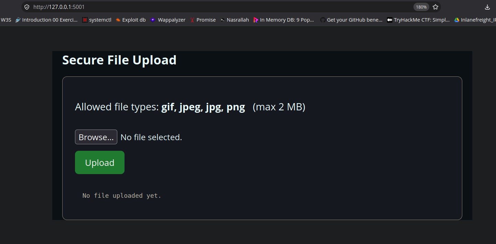
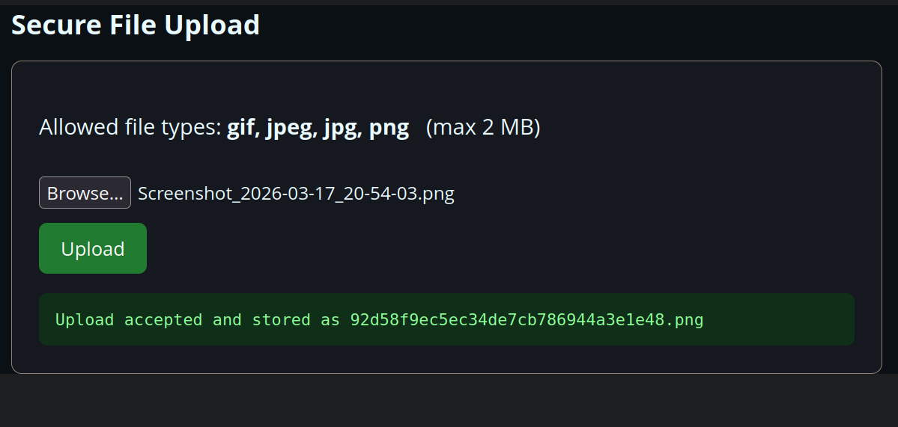
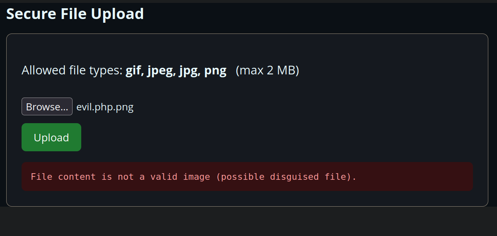
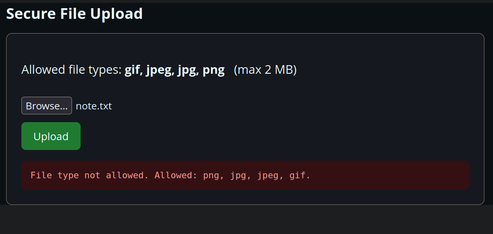
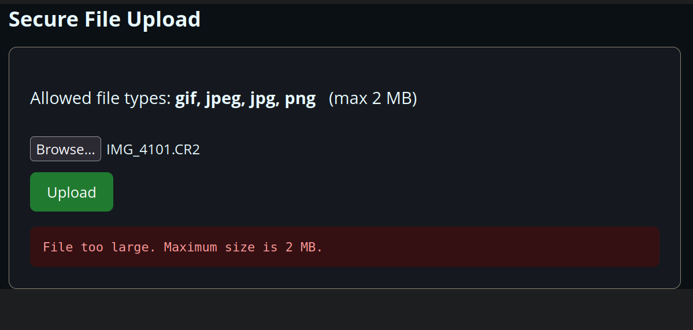

# Assignment 3: Secure File Upload Feature

### Objective
The goal of this assignment was to build a simple file upload feature for a web app and then secure it, so that someone can't just upload a malicious file and do damage to the server.

### Why File Uploads Are Risky
Upload forms are one of those features that look harmless but are actually a favourite target for attackers. If you don't check what's coming in, a few things can go wrong:

- Someone uploads a web shell like `shell.php` and then uses it to run commands on the server.
- A script gets renamed to something like `photo.png` to trick a lazy check into thinking it's just an image.
- Double extensions such as `shell.php.png` are used to sneak past basic filters.
- A filename like `../../config.php` is used to climb out of the upload folder and overwrite files it shouldn't (path traversal).
- Huge files are uploaded over and over to fill up the disk.

So the point here was to cover all of these, not just one.

### Prerequisites
```
pip install flask pillow
```

### The Security Measures I Added
I ended up using five separate checks. The idea is that each one catches a different type of attack, so even if one of them somehow gets bypassed, the others are still there. This layered approach is usually called *defence in depth*.

**1. Limiting the file size**
First thing is a size cap, otherwise someone could just upload massive files until the disk is full.
```python
app.config["MAX_CONTENT_LENGTH"] = 2 * 1024 * 1024   # 2 MB
```

**2. Allowing only certain extensions**
I went with an allowlist instead of a blocklist. A blocklist never really works because you can't possibly list every bad extension out there, so it's safer to just say what *is* allowed and reject everything else.
```python
ALLOWED_EXTENSIONS = {"png", "jpg", "jpeg", "gif"}
```

**3. Checking the actual file content**
This is probably the most important check. Instead of trusting the file name, the file is actually opened and parsed as an image. If it isn't a real image, it gets rejected, which is how a PHP script renamed to `.png` gets caught. An extension check on its own would never spot that.
```python
from PIL import Image
img = Image.open(stream)
img.verify()                 # throws an error if it's not a genuine image
```

**4. Cleaning up the filename**
`secure_filename()` strips out any directory parts and weird characters, so something like `../../../etc/passwd` can't break out of the upload folder. That's what stops the path traversal trick.
```python
safe_name = secure_filename(file.filename)
```

**5. Renaming the file**
Finally, every file that passes gets saved under a brand new random name with a safe extension. This way an attacker can't overwrite an existing file, and double-extension tricks like `shell.php.png` don't survive either.
```python
new_name = secrets.token_hex(16) + "." + ext
```

### Procedure

1. Install the requirements and run the app.
```
pip install flask pillow
python3 app.py
```

2. Go to `http://127.0.0.1:5001` in the browser and the upload form shows up.


3. Upload a normal image (a real `.png`). It goes through fine and gets saved under a new random name.


4. Now make a fake image that's really just code inside, and try uploading it:
```
printf '<?php system($_GET["c"]); ?>' > evil.php.png
```
It gets rejected, because the content isn't actually an image.


5. Try something with a blocked extension like `note.txt`. Rejected by the extension allowlist.


6. Try a file bigger than 2 MB. Rejected by the size limit.


### Testing and Results
Here's a summary of everything I tested:

| # | Test | Input | What it stops | Result |
|---|---|---|---|---|
| 1 | Valid image | `real.png` (true PNG) | — | Accepted |
| 2 | Disguised script | `evil.php.png` (PHP inside) | Web shell / disguised file | Rejected (content check) |
| 3 | Path traversal name | `../../../etc/passwd.png` | Overwriting server files | Name cleaned, stored safely |
| 4 | Bad extension | `note.txt` | Non-approved file types | Rejected (extension allowlist) |
| 5 | Oversized file | 3 MB file | Denial of service | Rejected (size limit) |
| 6 | Double extension | `shell.php.png` | Filter bypass | Blocked (content check + rename) |

In the end every malicious file got blocked, and only the real image was accepted and saved with a random, safe name.

### Risk Analysis
The worst thing that can happen with an upload feature is remote code execution, basically an attacker getting a web shell onto the server and running their own commands. The two checks that matter most for stopping that are the content validation (the file has to genuinely be an image) and storing the file somewhere the server won't execute it. The rest of the measures, the size limit, the extension allowlist, the filename cleaning and the renaming, are there to close the smaller gaps. Since they all stack together, getting past just one of them isn't enough to break in.

### Recommendations for a Real Deployment
If this were going into production I'd also want to:

- Serve the uploaded files from a separate domain or a storage service instead of the app folder.
- Set up the web server so the upload directory is treated as plain static files, with no script execution allowed.
- Run antivirus scanning on uploads where that's possible.
- Run the app as a low-privilege user rather than root.
- Keep logs of every upload for auditing.

### Conclusion
Overall the app does what was asked: it lets you upload files but stays safe by layering several checks on top of each other. Between them they handle disguised scripts, double extensions, path traversal, oversized files and disallowed types. If I had to pick the two most important ones, it'd be validating the real content of the file and making sure it's stored somewhere it can never be run. Those two together deal with the scariest outcome, which is an attacker ending up with code execution on the server.

### Files
```
Assignment_3/
├── app.py                # secure Flask back end
├── templates/
│   └── index.html        # upload form front end
├── assets/               # screenshots
└── README.MD
```